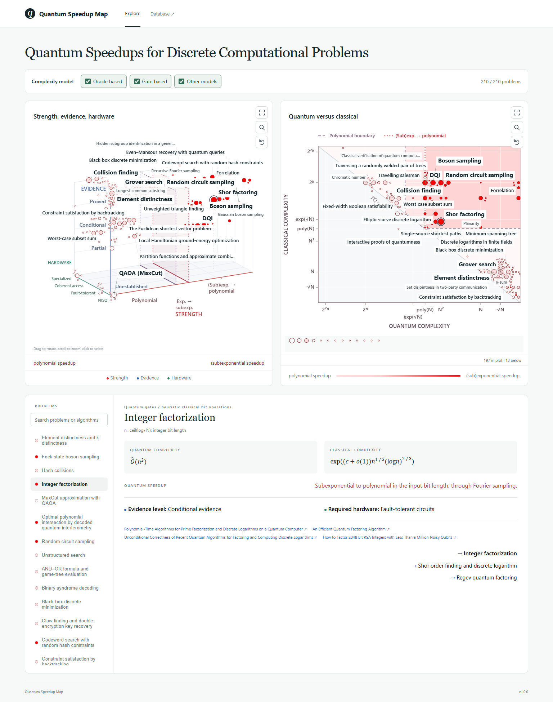

# Quantum Speedup Map

A structured catalogue of quantum speedups for discrete computational problems, with a separate chapter on complexity bounds and implications.

**Version 1.0.0** · [Website](https://kkzky.github.io/Quantum-Speedup-Map/) · [Release and downloads](https://github.com/kkzky/Quantum-Speedup-Map/releases/tag/v1.0.0) · [Citation](CITATION.cff)

The catalogue contains **211 problem entries**, **165 shared algorithm records** and **296 literature records**. Each problem includes its formal statement, quantum and classical complexity comparisons, strength/evidence/hardware labels, and primary literature with definition or theorem locations. Dataset counts are recorded in [`data/catalogue.json`](data/catalogue.json).

## Scope

The four chapters are:

1. Exact combinatorial optimization and search.
2. Graph algorithms and discrete optimization.
3. Cryptanalysis and post-quantum problems.
4. Complexity bounds and implications.

The first three chapters concern discrete objects and configurations, including integers, finite fields and groups, and lattices. They include real-valued weights, approximate outputs and continuous or simulation subroutines used to solve discrete target problems. The fourth chapter also covers continuous and quantum-state problems that inform quantum complexity classes.

## Interactive map

The map plots 210 problems with quantum algorithms and links a rotatable three-dimensional view of speedup, evidence and hardware requirements with a quantum-versus-classical complexity plot. Both plots support fullscreen, problem/algorithm search, reset and shared Oracle/Gate resource-model filters. Speedup regions have explicit boundaries. Problem and algorithm pages support cross-references and wiki search. Point and label sizes reflect editorial importance.

[Open the interactive map](https://kkzky.github.io/Quantum-Speedup-Map/). The [standalone visualization](visualization/quantum-speedup-map.html) also opens directly in a browser. [Run locally](visualization/README.md).

The production website is deployed from published stable Releases. Development commits remain available in the repository; publishing a Release updates the website to that tagged version. The footer links to the deployed release.



## Data

| Location | Contents |
| --- | --- |
| [`data/catalogue.json`](data/catalogue.json) | Catalogue metadata, chapter definitions, classification categories, conventions and entry order. |
| [`data/entries/`](data/entries/) | One structured JSON record per problem, with redirects for merged entries. |
| [`data/full_catalogue.json`](data/full_catalogue.json) | Complete problem and algorithm graph, including cross-references. |
| [`data/algorithms.json`](data/algorithms.json) | Independent algorithm records, literature and problem applications. |
| [`data/additions/`](data/additions/) | Research additions and their originating candidate records. |
| [`data/references.json`](data/references.json) | Shared literature records and access links. |
| [`data/citations.json`](data/citations.json) | Individual citations, linked to an entry, section and literature record, with the original URL and local locator. |
| [`data/reference_access.json`](data/reference_access.json) | Additional full-text access routes and their provenance. |
| [`data/relations.json`](data/relations.json) | Problem groups connected through shared algorithms. |
| [`data/quantum_speedups.sqlite`](data/quantum_speedups.sqlite) | Queryable relational database, including full-text search. |
| [`sources/catalogue-preview.tex`](sources/catalogue-preview.tex) | English TeX source snapshot supplying the manuscript entries and algorithm appendix. |
| [`docs/data-model.md`](docs/data-model.md) | Field definitions, identifiers, links and maintenance conventions. |

JSON records preserve mathematical expressions in LaTeX. Derived text fields remove prose formatting while retaining formulas in LaTeX for search. Citation records keep literature links at the section or algorithm-index item where they occur, including theorem, section, equation and page locators supplied in the catalogue.

Access links distinguish URLs recorded in the catalogue or research notes from links resolved from a landing page and standard arXiv PDF routes. This provenance records how a link was obtained. The original citation URL is retained alongside additional access routes.

## Rebuild

From the repository root:

```sh
python -m pip install -r requirements.txt
python scripts/build_all.py
```

The build reads the manuscript snapshot and research additions committed to this repository, exports JSON and SQLite, and renders every problem and algorithm page. Website assets are generated in `site/`, and the standalone map is written to `visualization/quantum-speedup-map.html`. Both use the same catalogue and the version recorded in `VERSION`.

To import an updated manuscript explicitly, run `python scripts/import_manuscript.py --source "path/to/catalogue.tex"`, review and commit the updated source, then rebuild.

## Releases and citation

The [v1.0.0 release](https://github.com/kkzky/Quantum-Speedup-Map/releases/tag/v1.0.0) includes:

- [Offline HTML map](https://github.com/kkzky/Quantum-Speedup-Map/releases/download/v1.0.0/quantum-speedup-map-v1.0.0.html)
- [JSON data archive](https://github.com/kkzky/Quantum-Speedup-Map/releases/download/v1.0.0/quantum-speedup-map-data-v1.0.0.zip)
- [SQLite database](https://github.com/kkzky/Quantum-Speedup-Map/releases/download/v1.0.0/quantum-speedups-v1.0.0.sqlite)

GitHub also provides source archives for the release tag. The [citation file](CITATION.cff) records the project author, version, release date and repository URL. After building, `python scripts/package_release.py` creates the release files in `dist/` and the deployable website in `_site/`. See [Publishing releases](docs/releasing.md) for the release workflow.

## Query examples

Open `data/quantum_speedups.sqlite` in a SQLite client. The following query selects entries whose strongest strength category is exponential or subexponential to polynomial:

```sql
SELECT e.title
FROM entries AS e
JOIN entry_labels AS l ON l.entry_id = e.id
WHERE l.dimension = 'strength'
  AND l.category_id = 'strength-exponential-subexponential-to-polynomial'
ORDER BY e.ordinal;
```

Find the entries and locations citing Grover's original search paper:

```sql
SELECT e.title, c.section, c.locator_latex, c.url
FROM citations AS c
JOIN entries AS e ON e.id = c.entry_id
JOIN "references" AS r ON r.id = c.reference_id
WHERE json_extract(r.external_ids_json, '$.arxiv') = 'quant-ph/9605043'
ORDER BY e.ordinal, c.id;
```

Search problem statements, complexity comparisons, labels and algorithm references:

```sql
SELECT e.title
FROM entry_search
JOIN entries AS e ON e.id = entry_search.id
WHERE entry_search MATCH '"subset sum" OR lattice'
ORDER BY bm25(entry_search), e.ordinal;
```

Find all applications of a shared algorithm:

```sql
SELECT e.title, a.usage_latex
FROM algorithm_applications AS a
JOIN entries AS e ON e.id = a.entry_id
WHERE a.algorithm_id = 'grover'
ORDER BY e.ordinal;
```

Search both problem and algorithm names:

```sql
SELECT id, kind, title
FROM entity_search
WHERE entity_search MATCH '"hidden subgroup"';
```

## Classification

Strength, evidence and hardware are separate dimensions. A strength label records the strongest supported comparison across the entry's parameter regimes; complexity fields preserve the general parameter dependence and the conditions of each comparison. The existing red, blue and green color values are stored with the categories.

The strength categories are polynomial speedup, improved exponential/subexponential complexity, exponential to subexponential, and exponential or subexponential to polynomial. A fixed-constant improvement from $2^{an}$ to $2^{bn}$, with $0<b<a$, is a polynomial speedup. “Power saving” refers to a decrease in the power of the input size inside the exponent.

## License

Repository data and code are provided under the [MIT license](LICENSE). Linked papers retain their respective copyrights and licenses.
